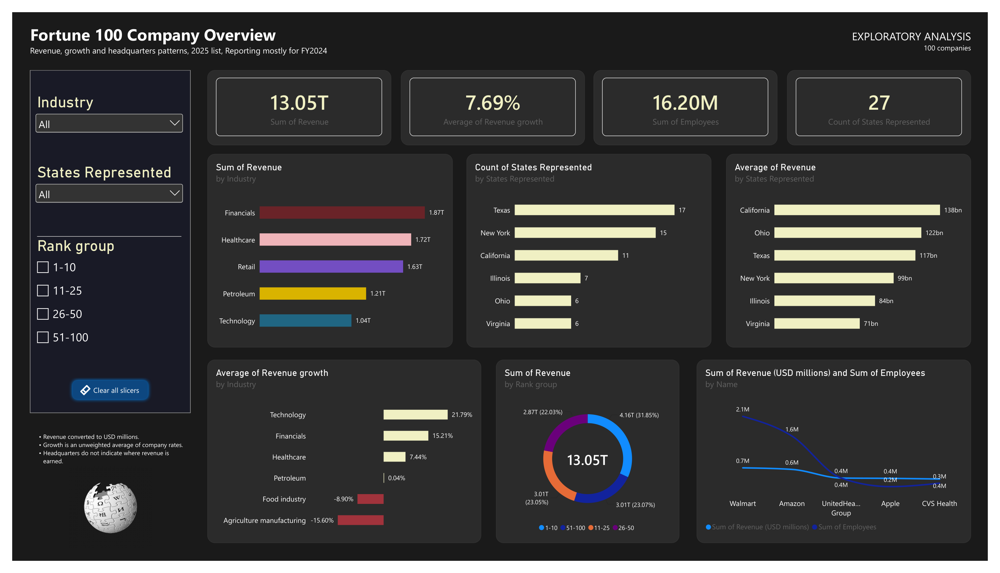

# Fortune 100 Companies: Revenue Analysis & Business Intelligence

An end-to-end data analytics project exploring the 100 largest companies in the United States by revenue, using Python for web scraping, Microsoft Excel for data preparation and exploratory analysis, and Power BI for interactive data visualization.

## Project Overview

This project explores the revenue performance, industry distribution, revenue growth, employee statistics, and geographical distribution of the 100 largest companies in the United States.

The project started with extracting company information directly from Wikipedia using Python. The extracted dataset was subsequently transferred into Excel for cleaning, transformation, and exploratory analysis before being imported into Power BI to develop an interactive dashboard.

The objective was to demonstrate an end-to-end data analytics workflow, from data extraction to business intelligence and visual reporting.

## Project Objectives

- Extract structured company information from a web-based source using Python.
- Prepare and clean the extracted dataset for analysis.
- Explore revenue, industry, employee, and geographical patterns.
- Identify differences in company performance across industries and ranking groups.
- Develop an interactive Power BI dashboard to communicate analytical findings.

## Dataset

**Source:** [List of largest companies in the United States by revenue – Wikipedia](https://en.wikipedia.org/wiki/List_of_largest_companies_in_the_United_States_by_revenue)

The dataset contains 100 companies from the 2025 ranking, with financial figures mostly relating to fiscal year 2024.

### Dataset attributes

| Column | Description |
|---|---|
| Rank | Company's position in the ranking |
| Name | Company name |
| Industry | Company's primary industry |
| Revenue | Reported revenue in USD millions |
| Revenue Growth | Reported revenue growth percentage |
| Employees | Number of employees |
| Headquarters | Company's headquarters location |

## Tools & Technologies

- **Python:** Web scraping and data extraction.
- **Jupyter Notebook:** Writing and executing Python code.
- **Requests:** Retrieving webpage content.
- **BeautifulSoup:** Parsing HTML and extracting table data.
- **Pandas:** Structuring and exporting extracted data.
- **Microsoft Excel:** Data cleaning, helper columns, data transformation, and pivot table analysis.
- **Microsoft Power BI:** Interactive dashboard development and data visualization.
- **GitHub:** Project documentation and version-controlled project hosting.

## Project Workflow

### 1. Data Extraction – Python Web Scraping

The project began by extracting company information from Wikipedia using Python.

The Requests library was used to retrieve the webpage, while BeautifulSoup was used to parse the HTML structure and locate the target company table.

Pandas was subsequently used to structure the extracted records into a DataFrame and export the dataset into CSV format.

**Key activities:**
- Retrieved webpage content.
- Parsed the HTML table.
- Extracted table headers and company records.
- Structured the extracted information using Pandas.
- Exported the dataset into CSV format.

Notebook: `Web_Scrapping.ipynb`

### 2. Data Preparation & Exploratory Analysis – Microsoft Excel

The extracted CSV dataset was imported into Excel for further preparation and exploration.

**Key activities:**
- Inspected and cleaned the extracted dataset.
- Converted revenue, revenue growth, and employee columns into appropriate numerical formats.
- Created helper columns to support further analysis, including ranking groups and headquarters state.
- Developed pivot tables to explore company performance and distribution.

**Exploratory analysis included:**
- Total revenue by industry.
- Average revenue by industry.
- Average revenue growth by industry.
- Employee distribution across industries.
- Number of company headquarters by state.
- Total and average revenue by headquarters state.
- Revenue distribution across ranking groups.

Workbook: `Companies(Final).xlsx`

### 3. Interactive Dashboard Development – Power BI

The prepared Excel dataset was imported into Power BI to develop an interactive dashboard titled **Fortune 100 Company Overview**.

The dashboard brings together key performance indicators and visual comparisons to provide an overview of the companies included in the dataset.

**Dashboard components:**

- Total company revenue.
- Average revenue growth.
- Total employee count.
- Number of headquarters states represented.
- Revenue distribution across industries.
- Company headquarters distribution by state.
- Average revenue by headquarters state.
- Revenue growth comparisons across industries.
- Revenue distribution across ranking groups.
- Revenue and employee comparisons for selected companies.

**Interactive features:**
- Industry slicer.
- Headquarters state slicer.
- Rank group slicer.
- Clear-all-slicers button.

Power BI file: `Fortune_100_dashboard.pbix`

## Dashboard Preview

## Key Analytical Questions

The analysis was guided by questions such as:

1. Which industries account for the highest total revenue?
2. Which industries have the highest average revenue growth?
3. How are the headquarters of the largest companies distributed across US states?
4. Which states have the highest average company revenue?
5. How does revenue distribution differ across company ranking groups?
6. How do revenue and employee figures compare among selected major companies?

## Important Considerations & Limitations

- The dataset represents the 2025 company ranking, with revenue figures mostly relating to fiscal year 2024.
- Revenue figures are expressed in USD millions in the original dataset.
- Revenue growth is analysed using the reported company growth percentages. Industry averages are unweighted averages unless otherwise specified.
- Headquarters location represents the recorded company headquarters, not necessarily the geographical locations where revenue is generated.
- The analysis is limited to the 100 companies included in the selected ranking and should not be interpreted as a representation of every company operating in the United States.
- The results reflect the source data at the time of extraction and may change when the original webpage is updated.

## What I Learned

This project provided practical experience in connecting multiple data analytics tools within a single workflow.

Some of the key skills developed include:

- Extracting structured information from webpages using Python.
- Understanding HTML table structures and web scraping.
- Working with Pandas DataFrames.
- Preparing datasets for exploratory analysis.
- Creating helper columns and pivot tables in Excel.
- Designing interactive dashboards in Power BI.
- Communicating analytical information through data visualization.

## Acknowledgements

Data source: [Wikipedia – List of largest companies in the United States by revenue](https://en.wikipedia.org/wiki/List_of_largest_companies_in_the_United_States_by_revenue)

This project was completed as part of my continuous learning journey in data analytics, with a focus on developing practical skills in Python, Excel, and Power BI.

---

**Author:** Fuad Afeez

**GitHub:** [@phyad](https://github.com/phyad)

